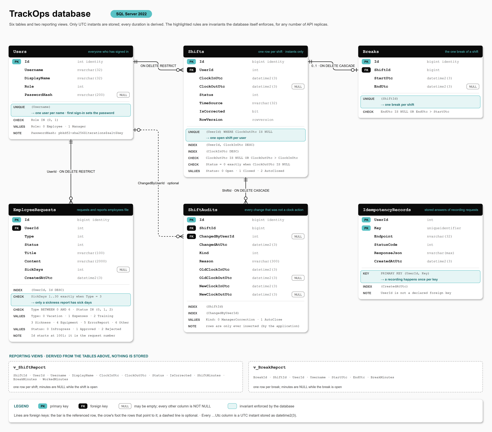

# TrackOps — shift clock (שעון נוכחות)

Employees clock in and out of shifts, take one break per shift, and see their hours and overtime. A manager
role (everyone's shifts, corrections with an audit trail) is built in and switched off by default.

**The one hard rule:** every recorded timestamp comes from an external time API for
Europe/Zurich. The browser clock and the server clock are never used for recording. If the time
API cannot be reached, nothing is recorded and the request fails with `503`.

| Part | Technology |
|---|---|
| Backend | ASP.NET Core on .NET 11, EF Core |
| Database | Microsoft SQL Server 2022 |
| Sessions, rate limits, cache | Redis |
| Frontend | React + TypeScript (Vite), Hebrew, right-to-left |
| Gateway | nginx in front of two backend replicas |
| Tests | pytest, black-box against the running stack |

## How to run

> **Quick start** — Windows with Docker Desktop running and internet access. In PowerShell, in
> the repository folder:
>
> ```powershell
> docker run --rm -v "${PWD}:/app" -w /app python:3.13-alpine python tools/make_env.py
> docker compose up -d --build
> ```
>
> Then open **<http://localhost:8080>** and sign in with a new username and any password of 8 or
> more characters. The first build takes 5 to 10 minutes. Nothing else needs installing: no .NET
> SDK, Node or Python. The steps below explain each command, the other shells, macOS, and what to
> do if something fails.

### What you need

| For | What | How to check |
|---|---|---|
| Running the app | **Docker Desktop** (Windows, macOS) or Docker Engine with the Compose plugin (Linux) | `docker compose version` prints v2.x |
| | At least 4 GB of memory for Docker (SQL Server alone needs 2 GB), about 4 GB of free disk, and port 8080 free | Docker Desktop → Settings → Resources |
| | **Internet access.** While building, Docker downloads the base images and the NuGet and npm packages. While running, the API asks two public time services for the time on every clock-in and clock-out, over HTTPS (port 443) | `curl.exe -s "https://timeapi.io/api/timezone/zone?timeZone=Europe/Zurich"` (PowerShell) or `curl -s …` (Git Bash, macOS, Linux) prints JSON |
| Running the tests (optional) | Python 3.12 or newer | `python --version` |
| Working on the code (optional) | .NET SDK 11, Visual Studio 2026 18.7 or newer, Node 22 — see "Working on the code" | `dotnet --list-sdks` |

To run the app you do **not** need the .NET SDK, Node or Python: everything is built inside
Docker. No accounts or API keys are needed either; both time services are free and keyless. Behind
a company proxy, set the proxy in Docker Desktop (Settings → Resources → Proxies), or the time
services cannot be reached and clocking in returns an error (see "If something goes wrong").

On Windows the commands below work in PowerShell or Git Bash; where they differ, both are shown.
On a Mac, first read "Windows, macOS and Linux" under "More about running it".

### 1. Create `.env`

`.env` holds every setting and secret. It is gitignored and never committed. The helper
`tools/make_env.py` copies `.env.example` to `.env` and fills each `CHANGE_ME` with a new random
value that meets every rule below. It never overwrites an existing `.env`, and it prints the names
it filled in, not the values. Run it **through Docker**, so Python is not needed:

```powershell
docker run --rm -v "${PWD}:/app" -w /app python:3.13-alpine python tools/make_env.py
```

```bash
# Git Bash on Windows
MSYS_NO_PATHCONV=1 docker run --rm -v "$(pwd -W):/app" -w /app python:3.13-alpine python tools/make_env.py
```

```bash
# macOS and Linux
docker run --rm -v "$PWD:/app" -w /app --user "$(id -u):$(id -g)" python:3.13-alpine python tools/make_env.py
```

With Python installed, `python tools/make_env.py` does the same.

To fill it in by hand instead, copy the example (`cp .env.example .env`, or `Copy-Item .env.example .env`
in PowerShell) and replace each `CHANGE_ME`. Every variable:

| Variable | Required | What it is | What to put |
|---|---|---|---|
| `ACCEPT_EULA` | yes | Accepts Microsoft's licence for the SQL Server Developer image | `Y` |
| `MSSQL_SA_PASSWORD` | yes | SQL Server's admin password; used only by the database container and the one-shot migrator | A password you invent (see the rules below) |
| `APP_DB_LOGIN` | yes | The least-privilege login the API uses; the migrator creates it | Keep `trackops_app` |
| `APP_DB_PASSWORD` | yes | Password of that login | A password you invent (see the rules below) |
| `REDIS_PASSWORD` | yes | Password of Redis (sessions, rate limits, cache) | A random value |
| `JWT_KEY` | yes | Signs the session tokens | A random value of 32+ characters |
| `CSRF_KEY` | yes | Signs the CSRF tokens | A random value of 32+ characters |
| `REQUIRE_HTTPS` | yes | `false` locally (plain HTTP); `true` in production, which turns on `Secure` cookies and HSTS | Keep `false` |
| `HSTS_HEADER_VALUE` | no | The HSTS header, production only | Leave empty |
| `PUBLIC_ORIGIN` | no | The address you open in the browser; the only origin CORS allows | `http://localhost:8080` |
| `PUBLIC_PORT` | no | The port on your machine | `8080`; if you change it, change `PUBLIC_ORIGIN` to match |
| `MANAGER_USERNAME` | no | The one username that signs in as a manager; empty means nobody | Empty (see "Manager access") |
| `DAILY_TARGET_MINUTES` | no | Daily target; minutes above it are overtime | `480` |
| `MAX_SHIFT_HOURS` | no | A shift left open longer than this is closed automatically | `16` |

Rules for the values:
- **The two SQL Server passwords** must satisfy SQL Server's policy, or the database container
  stops at once: at least 8 characters, with upper case, lower case, digits and a symbol. Use only
  letters, digits and `- _ . !`.
- **No value may contain** `$`, quotes, `;` or spaces: they break the compose file or the
  database connection string.
- A random value for the keys and the Redis password: `openssl rand -hex 32` (Git Bash, macOS,
  Linux), or in PowerShell:
  `$b = New-Object byte[] 32; [Security.Cryptography.RandomNumberGenerator]::Create().GetBytes($b); -join ($b | % { $_.ToString('x2') })`

### 2. Start everything

```bash
docker compose up -d --build
```

The first run downloads about 2 GB (SQL Server alone is about 1.5 GB) and builds the API and the
frontend; allow 5 to 10 minutes. Later starts take seconds. There is no database step: see "The
database sets itself up" below.

### 3. Check that it runs

```bash
docker compose ps
```

`sqlserver` and `redis` should be `healthy`, `migrator` should show `Exited (0)` (it runs once and
stops), and `backend-1`, `backend-2`, `frontend` and `gateway` should be `Up`.

Then open <http://localhost:8080> and sign in. There is no separate sign-up: **the first sign-in
with a username creates that user, and the password you type then becomes its password.** Any
username works (3–32 letters, digits, `.`, `_`, `-`; upper and lower case are the same) with any
password of 8–128 characters. Every later sign-in with that username needs the same password; the
user's shifts and requests stay with it. After 5 wrong passwords within 15 minutes the username is
locked until those 15 minutes are over. Everyone signs in as an employee. Press
**כניסה** on the home screen: the clock-in time comes from the external time service.

### 4. Stop or reset

```bash
docker compose down        # stops everything; the database is kept
docker compose down -v     # stops everything and deletes the database
```

### If something goes wrong

| What you see | Why | What to do |
|---|---|---|
| `sqlserver` keeps restarting or is never `healthy` | A SQL Server password breaks the policy, or Docker has less than 2 GB of memory | `docker compose logs sqlserver`; fix the password in `.env` (then `docker compose down -v`, because the first password is stored with the database), or give Docker more memory |
| `docker compose up` fails with "port is already allocated" | Something else uses port 8080 | Set `PUBLIC_PORT` (for example 8081) and `PUBLIC_ORIGIN=http://localhost:8081` in `.env` |
| Clocking in shows "שירות הזמן החיצוני אינו זמין" (503 `time_source_unavailable`) | Neither time service could be reached. By design nothing is recorded with another clock | Check the internet connection, proxy or firewall with the `curl` command above, and try again |
| `docker compose` says a variable is not set | `.env` is missing or a required value is empty | Create it as in step 1 |
| Sign-in says "נחסמה זמנית" (429 `sign_in_locked`) | 5 wrong passwords for that username within 15 minutes | Wait the minutes the message names; the right password works again then |
| Sign-in says "שם המשתמש או הסיסמה שגויים" | That username already signed in once, with another password | Use the password from its first sign-in, or another username; `docker compose down -v` starts over with no users |
| Scripts on Windows are slow against `localhost` | Windows tries IPv6 first and waits two seconds | Use `127.0.0.1` instead of `localhost` in scripts |

## How it works

**Searches use the HTTP `QUERY` method** (RFC 10008, published June 2026). This was a deliberate
choice. A search is a read, so it should be safe and repeatable like `GET`; but its filter
(employee names, dates) should not sit in the URL, where it ends up in browser
history, proxy logs and server access logs. `QUERY` gives both: the filter travels in the request
body, and the method is defined as safe and idempotent, which `POST` is not.

.NET 11 is the first version whose HTTP layer knows the method (`HttpMethods.Query`,
`HttpMethods.IsQuery`). The API's `[HttpQuery]` attribute, its CORS policy and its CSRF check
are built on those. Older versions can route `QUERY` too, as an arbitrary verb string; .NET 11
was chosen so the method is a named part of the framework rather than a string literal. The
price is that .NET 11 is a standard-term support release, not LTS. Both trade-offs, and the
missing fallback, are in [DECISIONS.md](DECISIONS.md#5-api).

Why things are built the way they are: [DECISIONS.md](DECISIONS.md).
Security work, found / fixed / tested: [docs/SECURITY-REPORT.md](docs/SECURITY-REPORT.md).
API contract: [docs/api/API.md](docs/api/API.md).


## More about running it

### Manager access (off by default)

The task is a shift clock, so out of the box there is no manager. To switch the manager role on,
name one username in `.env` and restart:

```bash
MANAGER_USERNAME=admin
```

```bash
docker compose up -d
```

Whoever signs in with that username gets one more screen, Employees: every employee's shifts,
and corrections of clock-in and clock-out times with a reason and an audit trail. Clear the
setting and restart to switch it off again; the user's role follows at the next sign-in.

### What is real and what is a sample

- **Forms and data**: the hours this month, the weekly average and the chart of this week come
  from the user's real shifts. The vacation and sick-day cards show fixed sample numbers.
- **Requests and reports**: the two buttons open forms that file a real request
  (`POST /requests`). It is stored, gets a number from 1001 up and appears at the top of the table.
  The five rows numbered 0001–0005 are a sample history, so the screen is not empty on a new
  installation.
- **Events tab** under the calendar: a sample list, the same for every day.

### Demo data (optional, needs Python)

A new database is empty, and the application cannot create a shift in the past: the time of every
recording comes from the external time API. To try the History and Calendar screens with data,
run this once while the stack is up:

```bash
python tools/seed_demo_data.py
```

It needs Python 3.12+ on your machine, because it also runs `docker compose exec`. It gives the
employee `demo` six weeks of shifts: ordinary days, overtime, two shifts in one day,
a night shift across midnight, a shift the system closed automatically and one a manager
corrected. Sign in as `demo` with the password `demo-password`: the tool signs in `demo` and
`admin` first, so on a new database that becomes their password (`--password` sets another; if
`demo` already has a different password, the tool says so and stops). The tool needs only Python and
Docker, can be run again (it replaces its own rows and touches nothing else) and is never run
automatically. It writes the rows straight into SQL Server and marks them
`TimeSource = 'demo-seed'`, so demo rows can always be told apart from real recordings. "Today" is
taken from the application's `GET /time`, not from the computer's clock.

### The database sets itself up

There is no manual database step. On `docker compose up`:

1. `sqlserver` starts with the SA password from `.env`.
2. The one-shot `migrator` container waits for it, creates the `TrackOps` database, applies the
   EF Core migrations (tables, constraints, indexes, reporting views), and creates the
   least-privilege login `APP_DB_LOGIN` that the API uses. It then exits.
3. The two API replicas start only after the migrator succeeded.

The schema, with its keys, constraints and indexes:



To look at the data, the reporting views `dbo.v_ShiftReport` and `dbo.v_BreakReport` list every
shift and break with derived minutes:

```bash
docker compose exec sqlserver bash -c '/opt/mssql-tools18/bin/sqlcmd -C -S localhost -U sa -P "$MSSQL_SA_PASSWORD" -d TrackOps -Q "SELECT TOP 10 * FROM dbo.v_ShiftReport ORDER BY ClockInUtc DESC"'
```

To start again with an empty database:

```bash
docker compose down -v
```

### What runs

| Container | Role | Reachable from your machine |
|---|---|---|
| `gateway` | nginx: serves the app, load-balances `/api/` over both replicas | `localhost:8080` |
| `backend-1`, `backend-2` | The API, stateless | no |
| `frontend` | nginx with the built React files | no |
| `sqlserver` | Database | no |
| `redis` | Sessions, rate-limit counters, calendar cache | no |
| `migrator` | Runs once, then exits | no |

### Windows, macOS and Linux

Nothing here is pre-built for one kind of computer. The backend and frontend images are built on
your machine from the Dockerfiles, so they match its processor. The base images they start from:

| Image | Published for |
|---|---|
| .NET SDK and ASP.NET runtime 11 | Intel/AMD and ARM |
| Node 22, nginx, Redis, Python | Intel/AMD and ARM |
| SQL Server 2022 | Intel/AMD only |

- **Windows, Linux, or a Mac with an Intel processor:** nothing to do.
- **Mac with Apple Silicon (M1 and later):** everything runs natively except SQL Server, which
  Microsoft publishes for Intel/AMD only. `compose.yaml` names that platform, and Docker Desktop
  runs it under emulation. In Docker Desktop, *Settings → General*, keep **Use Rosetta for
  x86_64/amd64 emulation on Apple Silicon** switched on. The first start of the database is slower.

  What was checked: every base image except SQL Server is published for ARM (`linux/arm64`), and
  all four of the project's own images (API, migrator, frontend, test time stub) were built for
  `linux/arm64` under emulation on Windows, from the final code, and the ARM API started. What was not: a run on a real Apple Silicon Mac. There is
  a public report from October 2025 that macOS 26 broke this emulation for a SQL Server container. If the
  `sqlserver` container never becomes healthy on such a Mac, that is the likely cause, and the
  project then needs an Intel/AMD machine.

Why containers and not native installs: SQL Server cannot be installed on macOS at all, and
Redis has no native Windows build. Containers are the only way the same three commands work on
all three systems. Running the API and the frontend directly with `dotnet` and `npm` is still
possible for development (see "Working on the code").

### More replicas

The API keeps no state in its own memory, so another replica is two small edits:

1. In `compose.yaml`, copy the `backend-2` block as `backend-3` with `Security__ReplicaName: "3"`,
   and add `backend-3` to the gateway's `depends_on`.
2. In `infra/nginx/gateway.conf.template`, add `server backend-3:8080 resolve max_fails=2 fail_timeout=5s;`
   to the `upstream` block.

Then `docker compose up -d`. This was tried with three replicas: requests were shared evenly,
30 simultaneous clock-ins by one user still opened exactly one shift, and a session was accepted
by all three and revoked on all three at sign-out. [DECISIONS.md](DECISIONS.md#8-operations)
explains what makes that work.

### HTTPS

The local stack runs over plain HTTP. HTTPS would be my preference, but a certificate browsers
trust needs a real domain and hosting, which this project does not have, and a self-signed
certificate is not enough for modern browsers: they show a warning page for it. In real
production the site is served over HTTPS with a professionally issued certificate. This is listed
under the known limits in [DECISIONS.md](DECISIONS.md#10-not-done-and-known-limits).

The code is ready for that: the cookie `Secure` flag and the HSTS header are on by default and
are switched off only by `REQUIRE_HTTPS=false` in the local `.env`. A test verifies both in the
"on" position (see below).

### The external time API

The API asks <https://timeapi.io> first and <https://time.now> second. Both are free public
services. If both are down, clocking in or out returns `503` by design; the app does not guess
the time.

## Tests

The tests are optional for running the app and need **Python 3.12 or newer** (`python --version`;
on macOS and Linux it may be called `python3`). They replace the two time APIs with a stub they control, so they can set the clock (for
example to a DST night), slow it down or take it offline. Everything else is the real stack.

```bash
docker compose -f compose.yaml -f infra/compose.test.yaml up -d --build
python -m venv tests/.venv
tests/.venv/Scripts/python -m pip install -r tests/requirements.txt   # Linux/macOS: tests/.venv/bin/python
tests/.venv/Scripts/python -m pytest
```

About 200 tests, roughly four minutes. They cover clock in/out through the stub; fail-closed
behaviour when the time source is down, slow or wrong; DST days (23 h and 25 h) and overtime;
20 concurrent clock-ins across both replicas; idempotent retries; `QUERY` search and pagination;
filing requests and sickness reports; passwords and the lock after wrong ones;
401/403 on manager routes; CSRF; rate limiting; security headers; CORS; XSS and SQL injection
payloads; and a static check that no code outside the two time modules reads the system clock.

One test needs the stack in HTTPS mode and is skipped otherwise:

```bash
REQUIRE_HTTPS=true HSTS_HEADER_VALUE="max-age=31536000; includeSubDomains" docker compose -f compose.yaml -f infra/compose.test.yaml up -d
EXPECT_HTTPS=1 tests/.venv/Scripts/python -m pytest tests/test_security.py -k https
docker compose -f compose.yaml -f infra/compose.test.yaml up -d
```

One test checks the default, where nobody is a manager. The test stack has a manager (the other
tests need one), so this test is skipped unless the stack is started without one:

```bash
TEST_MANAGER_USERNAME= docker compose -f compose.yaml -f infra/compose.test.yaml up -d
EXPECT_NO_MANAGER=1 tests/.venv/Scripts/python -m pytest tests/test_auth.py -k without_a_configured_manager
docker compose -f compose.yaml -f infra/compose.test.yaml up -d
```

Variables the tests read, all optional:

| Variable | Where | Effect |
|---|---|---|
| `TRACKOPS_URL`, `TRACKOPS_STUB_URL`, `TRACKOPS_PUBLIC_ORIGIN` | pytest | Where the gateway and the stub are; defaults `http://127.0.0.1:8080`, `http://127.0.0.1:8090`, `http://localhost:8080` |
| `TEST_MANAGER_USERNAME` | test overlay | The manager on the test stack; default `admin` |
| `TEST_SIGN_IN_PER_MINUTE` | test overlay | Sign-in rate limit on the test stack; default very high, because every test signs in |
| `EXPECT_HTTPS`, `EXPECT_NO_MANAGER` | pytest | Set to `1` to run the two stack-mode tests above |

To return to the normal stack with the real time APIs:

```bash
docker compose up -d
```

Other checks:

```bash
dotnet list backend/TrackOps.sln package --vulnerable --include-transitive
npm --prefix frontend audit
tests/.venv/Scripts/python tools/lighthouse_a11y.py
```

## Project layout

```
compose.yaml            the stack; .env.example lists every variable
backend/                TrackOps.sln
  src/TrackOps.Domain          entities, Zurich day boundaries, work-time calculation
  src/TrackOps.Application     use cases, DTOs, interfaces (ITimeProvider, ...)
  src/TrackOps.Infrastructure  EF Core + migrations, Redis, time API clients, background job
  src/TrackOps.Api             controllers, middleware, auth
  src/TrackOps.Migrator        one-shot database setup
frontend/src/           app (router, shell), features (one folder per screen), shared (api, time, ui)
infra/                  nginx gateway config, test overlay
tests/                  pytest suites and the stub time API
tools/                  API and database diagram generators, Lighthouse runner, demo data
docs/                   API contract and diagram, database diagram, security report
.claude/                plans and the log of working with Claude Code
```

## Working on the code

- Backend: needs the **.NET SDK 11.0.100 or a later 11.0 SDK** (`backend/global.json` pins it).
  Download it from <https://dotnet.microsoft.com/download/dotnet/11.0>; `dotnet --list-sdks` should
  list an `11.0.x` line. Build with `dotnet build backend/TrackOps.sln`, or open `backend/TrackOps.sln`
  in **Visual Studio 2026, version 18.7 or newer**, with the "ASP.NET and web development"
  workload. Visual Studio 2022 cannot open it: the .NET 11 SDK needs Visual Studio's build engine
  18.7 or newer, and Visual Studio 2022 has 17.14 (its projects then fail to load with
  `MSB4236: The SDK 'Microsoft.NET.Sdk' specified could not be found`). The code-style settings sit
  next to the solution and are picked up by the IDE. After a change, rebuild the containers:
  `docker compose up -d --build backend-1 backend-2`.
- Frontend: needs Node 22 and npm. `npm --prefix frontend install`, then `npm --prefix frontend run dev`. The dev server
  proxies `/api` to the running stack.
- New migration: `dotnet ef migrations add <Name> --project src/TrackOps.Infrastructure --startup-project src/TrackOps.Infrastructure --output-dir Persistence/Migrations` (run in `backend/`).

### API diagram

The API map is drawn as a folder tree: each folder is a path segment and each endpoint is a leaf.
It is generated from the endpoint tree in `tools/build_api_diagram.py`. When the API changes, edit
that tree and `docs/api/API.md` together, then:

```bash
python tools/build_api_diagram.py
draw.io -x -f png -s 2 -b 24 -p 1 -o docs/api/rest-api.png docs/api/rest-api.drawio
draw.io -x -f png -s 2 -b 24 -p 2 -o docs/api/rest-api-clock-in-flow.png docs/api/rest-api.drawio
```

The database diagram is generated the same way from `tools/build_db_diagram.py`, which mirrors the
migrations:

```bash
python tools/build_db_diagram.py
draw.io -x -f png -s 2 -b 24 -o docs/db/schema.png docs/db/schema.drawio
```

(`draw.io` is the draw.io Desktop executable.)

## How this was built with Claude Code

The whole project was built with Claude Code, in plan mode with approval gates before any code.

| What | Where |
|---|---|
| The rules and conventions it works by, and the gotchas met along the way | [`CLAUDE.md`](CLAUDE.md) |
| The `.claude` folder | [`.claude/`](.claude/): the plans and the work log |
| The work plans, each approved before the work started | [`.claude/plans/`](.claude/plans/): the API contract and execution plan (before any code), the pre-submission review, the request hardening and passwords |
| Where it helped | [`.claude/WORKLOG.md` → Where Claude Code helped](.claude/WORKLOG.md#where-claude-code-helped) |
| Where I had to correct it | [Where I corrected Claude Code](.claude/WORKLOG.md#where-i-corrected-claude-code) and [Where Claude Code got something wrong and fixed it](.claude/WORKLOG.md#where-claude-code-got-something-wrong-and-fixed-it) |
| Where it corrected me | [Where Claude Code corrected me](.claude/WORKLOG.md#where-claude-code-corrected-me) |
| What was cut or left unverified | [What was cut or left unverified](.claude/WORKLOG.md#what-was-cut-or-left-unverified) |
