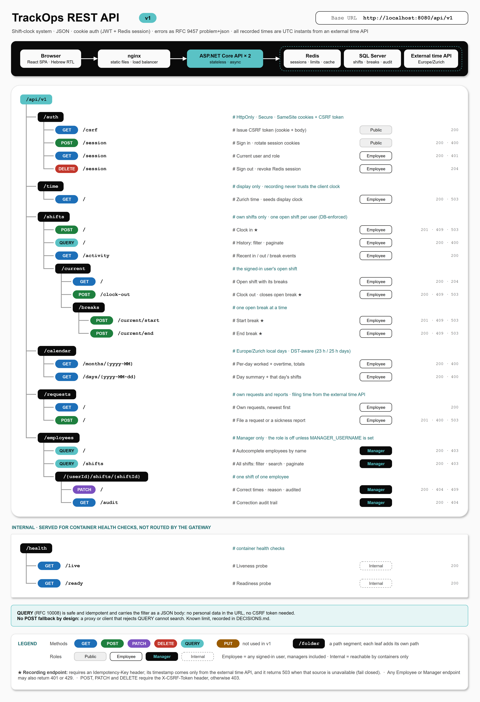
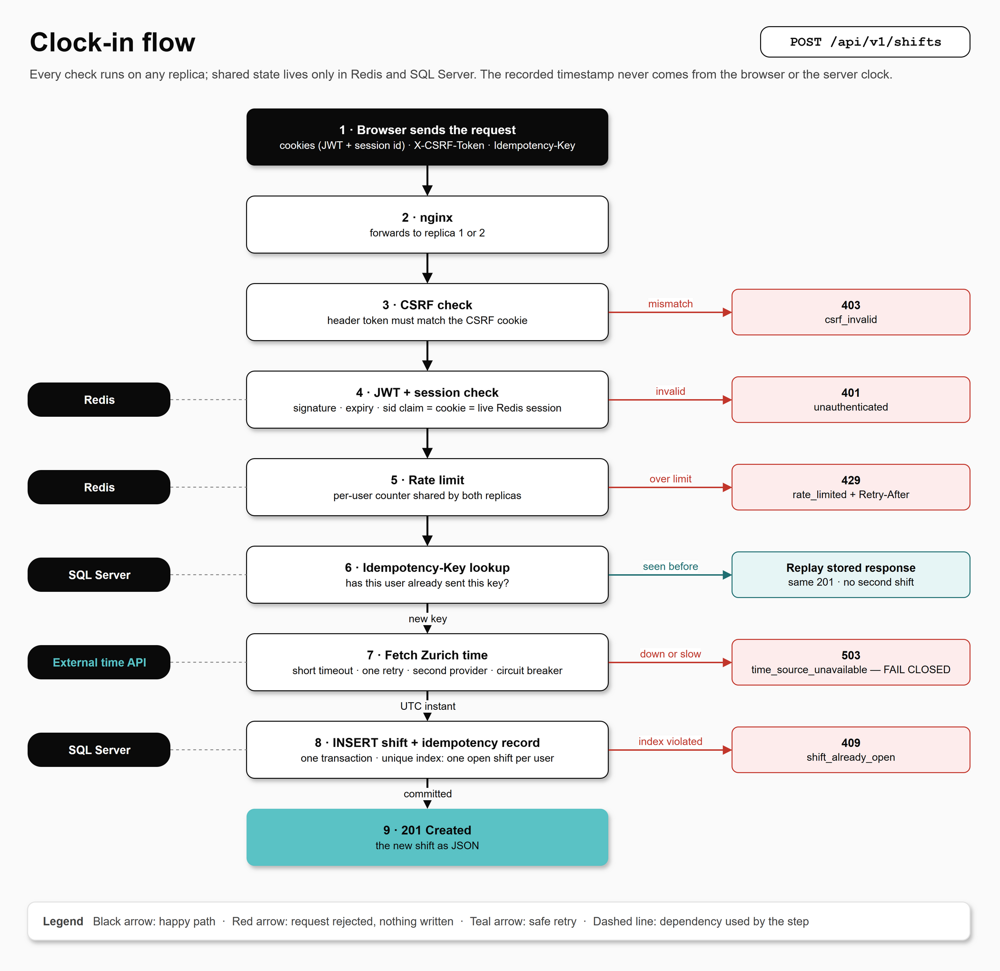

# TrackOps — shift clock (שעון נוכחות)

Employees clock in and out of shifts, take breaks, and see their hours and overtime. Managers see
everyone's shifts and can correct them, with an audit trail.

**The one hard rule:** every recorded timestamp comes from an external time API for
Europe/Zurich. The browser clock and the server clock are never used for recording. If the time
API cannot be reached, nothing is recorded and the request fails with `503`.

| Part | Technology |
|---|---|
| Backend | ASP.NET Core on .NET 11, EF Core |
| Database | Microsoft SQL Server 2022 |
| Sessions, rate limits, cache | Redis |
| Frontend | React + TypeScript (Vite), Hebrew, right-to-left |
| Gateway | nginx in front of two backend replicas |
| Tests | pytest, black-box against the running stack |

The backend runs on .NET 11.

**Searches use the HTTP `QUERY` method** (RFC 10008, published June 2026). This was a deliberate
choice. A search is a read, so it should be safe and repeatable like `GET`; but its filter
(employee names, dates, free text) should not sit in the URL, where it ends up in browser
history, proxy logs and server access logs. `QUERY` gives both: the filter travels in the request
body, and the method is defined as safe and idempotent, which `POST` is not.

.NET 11 is the first version whose HTTP layer knows the method (`HttpMethods.Query`,
`HttpMethods.IsQuery`). The API's `[HttpQuery]` attribute, its CORS policy and its CSRF check
are built on those. Older versions can route `QUERY` too, as an arbitrary verb string; .NET 11
was chosen so the method is a named part of the framework rather than a string literal. The
price is that .NET 11 is a standard-term support release, not LTS. Both trade-offs, and the
missing fallback, are in [DECISIONS.md](DECISIONS.md#5-api).

Why things are built the way they are: [DECISIONS.md](DECISIONS.md).
Security work, found / fixed / tested: [docs/SECURITY-REPORT.md](docs/SECURITY-REPORT.md).
API contract: [docs/api/API.md](docs/api/API.md).





## Run it locally

You need Docker Desktop (with Compose) and nothing else. On Windows use Git Bash or PowerShell.
On a Mac, read "Windows, macOS and Linux" below first.

**1. Create your `.env`.** It holds every secret; it is gitignored.

```bash
cp .env.example .env
```

Open `.env` and replace each `CHANGE_ME`. Generate a value with:

```bash
python -c "import secrets; print(secrets.token_urlsafe(48))"
```

- `ACCEPT_EULA=Y` means you accept Microsoft's licence for the SQL Server Developer image.
- `MSSQL_SA_PASSWORD` and `APP_DB_PASSWORD` must satisfy SQL Server's policy: 8+ characters with
  upper case, lower case, digits and symbols. Avoid quotes and semicolons.

**2. Start everything.**

```bash
docker compose up -d --build
```

The first run downloads the images (SQL Server is about 1.5 GB) and takes a few minutes.

**3. Open <http://localhost:8080>.**

Sign-in is a mock: any username (3–32 letters, digits, `.`, `_`, `-`) and any password of 8+
characters work. The username `admin` is the manager; every other name is an employee.

### The database sets itself up

There is no manual database step. On `docker compose up`:

1. `sqlserver` starts with the SA password from `.env`.
2. The one-shot `migrator` container waits for it, creates the `TrackOps` database, applies the
   EF Core migrations (tables, constraints, indexes, reporting views), and creates the
   least-privilege login `APP_DB_LOGIN` that the API uses. It then exits.
3. The two API replicas start only after the migrator succeeded.

The schema, with its keys, constraints and indexes:


To look at the data, the reporting views `dbo.v_ShiftReport` and `dbo.v_BreakReport` list every
shift and break with derived minutes:

```bash
docker compose exec sqlserver bash -c '/opt/mssql-tools18/bin/sqlcmd -C -S localhost -U sa -P "$MSSQL_SA_PASSWORD" -d TrackOps -Q "SELECT TOP 10 * FROM dbo.v_ShiftReport ORDER BY ClockInUtc DESC"'
```

To start again with an empty database:

```bash
docker compose down -v
```

### What runs

| Container | Role | Reachable from your machine |
|---|---|---|
| `gateway` | nginx: serves the app, load-balances `/api/` over both replicas | `localhost:8080` |
| `backend-1`, `backend-2` | The API, stateless | no |
| `frontend` | nginx with the built React files | no |
| `sqlserver` | Database | no |
| `redis` | Sessions, rate-limit counters, calendar cache | no |
| `migrator` | Runs once, then exits | no |

### Windows, macOS and Linux

Nothing here is pre-built for one kind of computer. The backend and frontend images are built on
your machine from the Dockerfiles, so they match its processor. The base images they start from:

| Image | Published for |
|---|---|
| .NET SDK and ASP.NET runtime 11 | Intel/AMD and ARM |
| Node 22, nginx, Redis, Python | Intel/AMD and ARM |
| SQL Server 2022 | Intel/AMD only |

- **Windows, Linux, or a Mac with an Intel processor:** nothing to do.
- **Mac with Apple Silicon (M1 and later):** everything runs natively except SQL Server, which
  Microsoft publishes for Intel/AMD only. `compose.yaml` names that platform, and Docker Desktop
  runs it under emulation. In Docker Desktop, *Settings → General*, keep **Use Rosetta for
  x86_64/amd64 emulation on Apple Silicon** switched on. The first start of the database is slower.

  This path was not tested: the project was built and verified on Windows. There is a public
  report from October 2025 that macOS 26 broke this emulation for a SQL Server container. If the
  `sqlserver` container never becomes healthy on such a Mac, that is the likely cause, and the
  project then needs an Intel/AMD machine.

Why containers and not native installs: SQL Server cannot be installed on macOS at all, and
Redis has no native Windows build. Containers are the only way the same three commands work on
all three systems. Running the API and the frontend directly with `dotnet` and `npm` is still
possible for development (see "Working on the code").

### More replicas

The API keeps no state in its own memory, so another replica is two small edits:

1. In `compose.yaml`, copy the `backend-2` block as `backend-3` with `Security__ReplicaName: "3"`,
   and add `backend-3` to the gateway's `depends_on`.
2. In `infra/nginx/gateway.conf.template`, add `server backend-3:8080 resolve max_fails=2 fail_timeout=5s;`
   to the `upstream` block.

Then `docker compose up -d`. This was tried with three replicas: requests were shared evenly,
30 simultaneous clock-ins by one user still opened exactly one shift, and a session was accepted
by all three and revoked on all three at sign-out. [DECISIONS.md](DECISIONS.md#8-operations)
explains what makes that work.

### HTTPS

The local stack runs over plain HTTP. HTTPS is not enabled locally because the certificate would
be self-signed, and browsers do not accept self-signed certificates without warnings. In real
production the site is served over HTTPS with a professionally issued certificate.

The code is ready for that: the cookie `Secure` flag and the HSTS header are on by default and
are switched off only by `REQUIRE_HTTPS=false` in the local `.env`. A test verifies both in the
"on" position (see below).

### The external time API

The API asks <https://timeapi.io> first and <https://time.now> second. Both are free public
services. If both are down, clocking in or out returns `503` by design; the app does not guess
the time.

## Tests

The tests replace the two time APIs with a stub they control, so they can set the clock (for
example to a DST night), slow it down or take it offline. Everything else is the real stack.

```bash
docker compose -f compose.yaml -f infra/compose.test.yaml up -d --build
python -m venv tests/.venv
tests/.venv/Scripts/python -m pip install -r tests/requirements.txt   # Linux/macOS: tests/.venv/bin/python
tests/.venv/Scripts/python -m pytest
```

About 150 tests, roughly four minutes. They cover clock in/out through the stub; fail-closed
behaviour when the time source is down, slow or wrong; DST days (23 h and 25 h) and overtime;
20 concurrent clock-ins across both replicas; idempotent retries; `QUERY` search and pagination;
401/403 on manager routes; CSRF; rate limiting; security headers; CORS; XSS and SQL injection
payloads; and a static check that no code outside the two time modules reads the system clock.

One test needs the stack in HTTPS mode and is skipped otherwise:

```bash
REQUIRE_HTTPS=true HSTS_HEADER_VALUE="max-age=31536000; includeSubDomains" docker compose -f compose.yaml -f infra/compose.test.yaml up -d
EXPECT_HTTPS=1 tests/.venv/Scripts/python -m pytest tests/test_security.py -k https
docker compose -f compose.yaml -f infra/compose.test.yaml up -d
```

To return to the normal stack with the real time APIs:

```bash
docker compose up -d
```

Other checks:

```bash
dotnet list backend/TrackOps.sln package --vulnerable --include-transitive
npm --prefix frontend audit
tests/.venv/Scripts/python tools/lighthouse_a11y.py
```

## Project layout

```
compose.yaml            the stack; .env.example lists every variable
backend/                TrackOps.sln
  src/TrackOps.Domain          entities, Zurich day boundaries, work-time calculation
  src/TrackOps.Application     use cases, DTOs, interfaces (ITimeProvider, ...)
  src/TrackOps.Infrastructure  EF Core + migrations, Redis, time API clients, background job
  src/TrackOps.Api             controllers, middleware, auth
  src/TrackOps.Migrator        one-shot database setup
frontend/src/           app (router, shell), features (one folder per screen), shared (api, time, ui)
infra/                  nginx gateway config, test overlay
tests/                  pytest suites and the stub time API
tools/                  API and database diagram generators, Lighthouse runner
docs/                   API contract and diagram, database diagram, security report
.claude/                plans and the log of working with Claude Code
```

## Working on the code

- Backend: open `backend/TrackOps.sln` (needs the .NET 11 SDK; the containers build without it). The code-style settings
  sit next to the solution and are picked up by the IDE. After a change, rebuild the containers:
  `docker compose up -d --build backend-1 backend-2`.
- Frontend: `npm --prefix frontend install`, then `npm --prefix frontend run dev`. The dev server
  proxies `/api` to the running stack.
- New migration: `dotnet ef migrations add <Name> --project src/TrackOps.Infrastructure --startup-project src/TrackOps.Infrastructure --output-dir Persistence/Migrations` (run in `backend/`).

### API diagram

The API map is drawn as a folder tree: each folder is a path segment and each endpoint is a leaf.
It is generated from the endpoint tree in `tools/build_api_diagram.py`. When the API changes, edit
that tree and `docs/api/API.md` together, then:

```bash
python tools/build_api_diagram.py
draw.io -x -f png -s 2 -b 24 -p 1 -o docs/api/rest-api.png docs/api/rest-api.drawio
draw.io -x -f png -s 2 -b 24 -p 2 -o docs/api/rest-api-clock-in-flow.png docs/api/rest-api.drawio
```

The database diagram is generated the same way from `tools/build_db_diagram.py`, which mirrors the
migrations:

```bash
python tools/build_db_diagram.py
draw.io -x -f png -s 2 -b 24 -o docs/db/schema.png docs/db/schema.drawio
```

(`draw.io` is the draw.io Desktop executable.)
