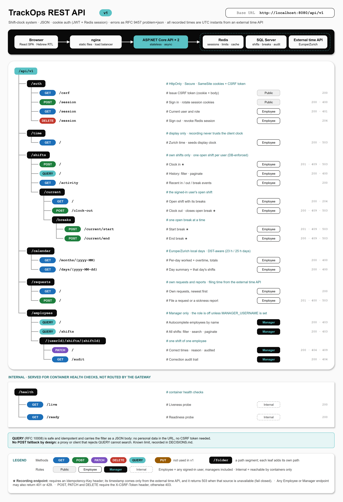
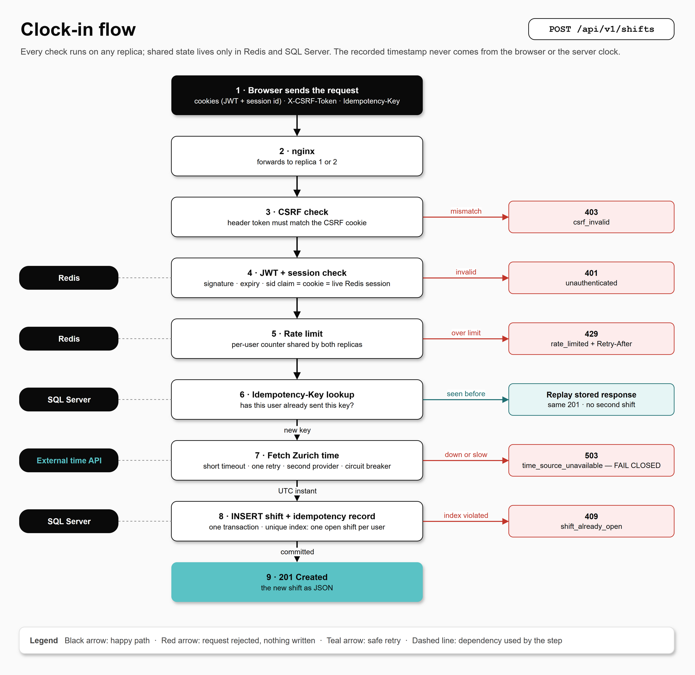

# TrackOps REST API — v1

Base URL (local): `http://localhost:8080/api/v1`

This file, `rest-api.drawio` and the two PNG exports describe the same contract. When the API
changes, update the endpoint table in `tools/build_api_diagram.py`, regenerate the diagram, and
update this file in the same commit.





## Conventions

- JSON in, JSON out. All instants are UTC, ISO-8601 with `Z`. The client formats them in
  Europe/Zurich. Calendar dates (`yyyy-MM-dd`, `yyyy-MM`) are Europe/Zurich local dates.
- Recorded timestamps come only from the external time API. No request body can carry a
  clock-in or clock-out time, except a manager correction.
- "Employee" means any signed-in user, managers included. "Manager" means the manager role only.

### Authentication

Sign-in sets two cookies, both `HttpOnly; SameSite=Strict` and `Secure` when
`Security__RequireHttps` is on (the default; off only in the local `.env`):

| Cookie | Content |
|---|---|
| `trackops_jwt` | JWT, 86400 s lifetime, with a `sid` claim |
| `trackops_sid` | Opaque session id |

A request is authenticated only when the JWT is valid, its `sid` claim equals the `trackops_sid`
cookie, and that session exists in Redis. Signing in rotates the session. Signing out deletes
it, so the JWT stops working immediately.

### CSRF

`GET /auth/csrf` returns `{ "token": "..." }` and sets the matching cookie. `POST`, `PATCH` and
`DELETE` must send the token in the `X-CSRF-Token` header, otherwise `403 csrf_invalid`.
`GET` and `QUERY` are safe methods and need no token. Fetch a new token after signing in.

### Errors

Every error is `application/problem+json` (RFC 9457):

```json
{
  "type": "https://trackops.local/problems/shift_already_open",
  "title": "A shift is already open",
  "status": 409,
  "code": "shift_already_open",
  "traceId": "00-...",
  "errors": { "field": ["message"] }
}
```

`errors` appears only on `400 validation_failed`.

| Status | Codes |
|---|---|
| 400 | `validation_failed`, `idempotency_key_required` |
| 401 | `unauthenticated` |
| 403 | `forbidden`, `csrf_invalid` |
| 404 | `not_found` (also returned for another user's shift) |
| 409 | `shift_already_open`, `no_open_shift`, `break_already_open`, `no_open_break`, `stale_version`, `shift_overlap`, `idempotency_key_reused` |
| 429 | `rate_limited` (with `Retry-After`) |
| 500 | `internal_error` (no details are returned) |
| 503 | `time_source_unavailable` (with `Retry-After`), `dependency_unavailable` |

### Idempotency

The four recording endpoints (marked ★) require an `Idempotency-Key` header holding a UUID.
The key and the response are stored in the same database transaction as the write. Sending the
same key again returns the stored response with `Idempotency-Replayed: true` and writes nothing.
Reusing a key on a different endpoint returns `409 idempotency_key_reused`.

### Pagination

List requests take `page` (1-based, default 1) and `pageSize` (default 20, max 100) and return:

```json
{ "items": [], "page": 1, "pageSize": 20, "totalItems": 0, "totalPages": 0 }
```

Order is newest clock-in first, then highest id.

### QUERY

Filtered lists use the HTTP `QUERY` method (RFC 10008) with a JSON body. It is safe and
idempotent. There is no POST fallback: a client or proxy that rejects `QUERY` cannot search.

### Rate limits

Counted in Redis, so both replicas share them. Limits are per minute and configurable.

| Scope | Default | Key |
|---|---|---|
| Sign-in | 10 | client IP |
| Recording endpoints | 30 | user |
| Search (`QUERY`) | 60 | user |
| Everything else | 240 | user |

## Shared shapes

```json
// Shift
{
  "id": 42, "userId": 7, "username": "dana", "displayName": "dana",
  "clockInUtc": "2026-11-17T07:00:12Z", "clockOutUtc": null,
  "status": "Open",            // Open | Closed | AutoClosed
  "note": null, "isCorrected": false, "rowVersion": "AAAAAAAAB9E=",
  "shiftMinutes": null, "breakMinutes": null, "workedMinutes": null,   // null while open
  "breaks": [ { "id": 5, "startUtc": "2026-11-17T10:00:03Z", "endUtc": null, "minutes": null } ]
}
```

```json
// User
{ "id": 7, "username": "dana", "displayName": "dana", "role": "Employee" }   // Employee | Manager
```

## Endpoints

### Auth

| Method | Path | Role | Success | Notes |
|---|---|---|---|---|
| GET | `/auth/csrf` | Public | 200 `{ token }` | |
| POST | `/auth/session` | Public | 200 User | Body `{ username, password }`. Mock sign-in: any valid-looking pair passes; `admin` is a Manager. 400 on invalid input. |
| GET | `/auth/session` | Employee | 200 User | 401 when not signed in. |
| DELETE | `/auth/session` | Employee | 204 | Revokes the session and clears the cookies. |

Username: 3–32 characters from `a-z A-Z 0-9 . _ -`, stored lower-case. Password: 8–128 characters.
No password is stored or compared.

### Time

| Method | Path | Role | Success | Notes |
|---|---|---|---|---|
| GET | `/time` | Employee | 200 `{ utc, zone, offsetSeconds, source }` | For seeding the display clock only: the latest external reading plus monotonic elapsed time. 503 only when no reading has ever been obtained. |

### Shifts

| Method | Path | Role | Success | Notes |
|---|---|---|---|---|
| POST | `/shifts` ★ | Employee | 201 Shift, `Location` | Clock in. 409 `shift_already_open`. 503. |
| POST | `/shifts/current/clock-out` ★ | Employee | 200 Shift | Optional body `{ note }` (max 200). Closes an open break at the same instant. 409 `no_open_shift`. 503. |
| GET | `/shifts/current` | Employee | 200 Shift, or 204 | |
| GET | `/shifts/{shiftId}` | Employee | 200 Shift | 404 for another user's shift. |
| GET | `/shifts/activity?limit=10` | Employee | 200 `{ items: [{ type, atUtc, shiftId }] }` | `type`: `ClockIn`, `ClockOut`, `BreakStart`, `BreakEnd`. `limit` 1–50. |
| QUERY | `/shifts` | Employee | 200 page of Shift | Body `{ from?, to?, status?: [..], search?, page?, pageSize? }`. `from`/`to` are local dates of clock-in, inclusive. `search` matches the note. |

### Breaks

| Method | Path | Role | Success | Notes |
|---|---|---|---|---|
| POST | `/shifts/current/breaks` ★ | Employee | 201 Shift | 409 `no_open_shift` or `break_already_open`. 503. |
| POST | `/shifts/current/breaks/current/end` ★ | Employee | 200 Shift | 409 `no_open_shift` or `no_open_break`. 503. |

### Calendar

| Method | Path | Role | Success |
|---|---|---|---|
| GET | `/calendar/months/{yyyy-MM}` | Employee | 200 `{ month, dailyTargetMinutes, days: [{ date, workedMinutes, breakMinutes, overtimeMinutes, shiftCount }], totals: { workedMinutes, overtimeMinutes, daysWorked, averageDailyOvertimeMinutes } }` |
| GET | `/calendar/days/{yyyy-MM-dd}` | Employee | 200 `{ date, dailyTargetMinutes, workedMinutes, breakMinutes, overtimeMinutes, shifts: [Shift] }`. `today` is accepted as the date. |

Worked time for a local day is the part of each shift between that day's two local midnights,
minus breaks in the same window. Overtime for a day is `max(0, worked − target)`. An open shift
counts up to the current time from the time source. A day lists every shift that touches it.

### Employees (Manager only)

| Method | Path | Success | Notes |
|---|---|---|---|
| QUERY | `/employees` | 200 `{ items: [User] }` | Body `{ search, limit? }`; `limit` 1–20. Prefix match on username and display name. |
| QUERY | `/employees/shifts` | 200 page of Shift | Body `{ userId?, from?, to?, status?, search?, page?, pageSize? }`. `search` matches username, display name or note. |
| PATCH | `/employees/{userId}/shifts/{shiftId}` | 200 Shift | Body `{ clockInUtc?, clockOutUtc?, reason, rowVersion }`. `reason` 3–300 characters. 409 `stale_version` or `shift_overlap`. Writes an audit row. |
| GET | `/employees/{userId}/shifts/{shiftId}/audit` | 200 `{ items: [{ id, kind, changedBy: User, changedAtUtc, reason, oldClockInUtc, oldClockOutUtc, newClockInUtc, newClockOutUtc }] }` | `kind`: `ManagerCorrection`, `AutoClose`. |

Everyone else gets 403 on these routes.

### Internal

`GET /health/live` and `GET /health/ready` are served by the backend for container health checks
and are not routed by nginx.
